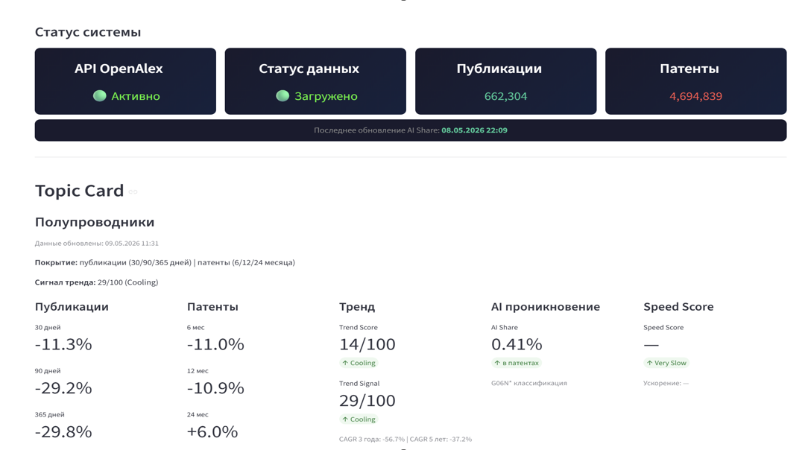
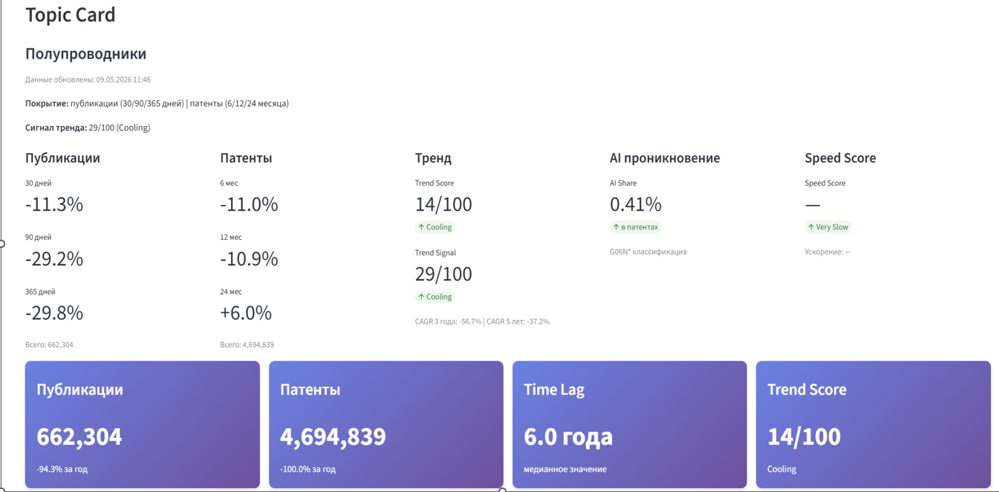
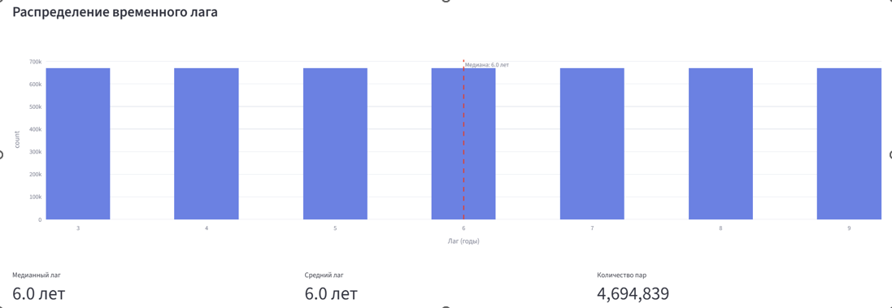

# Tech Trends Monitor (Data Science Platform)

## О проекте
Интерактивная аналитическая платформа для мониторинга перехода науки в технологии. Система собирает данные из открытых источников (OpenAlex, Google Patents), сопоставляет научные публикации и патенты, рассчитывает метрики трендов (Time Lag, Trend Score) и визуализирует их через единый интерфейс.

## Мой вклад в проект (Fullstack AI / Data Engineer)

В рамках командной разработки я отвечала за визуализацию, backend-разработку и DevOps:

1. **Разработка UI (Streamlit)**: Создала интерактивный дашборд с переключением доменов, фильтрацией, графиками Plotly (Dual-Axis «Наука vs Патенты», гистограмма лагов, геокарта) и Drill-down до конкретных статей/патентов.
2. **Backend & API (FastAPI)**: Разработала слой API для отдачи метрик (Topic Card, временные ряды), что обеспечило независимость дашборда от источника данных.
3. **DevOps & Оптимизация**:
   - **Снижение RAM с 94% до 38%** за счет внедрения `@st.cache_data`, выноса вычислений в бэкенд и оптимизации выборки (50K записей вместо 4.7 млн).
   - Развернула приложение на production-сервере (Ubuntu, systemd, SSH-туннели). Настроила cron для автообновления.
4. **Работа с Big Data**: Использовала **DuckDB** для агрегации датасетов до 33 млн строк без загрузки в RAM.

## Технологический стек
- **Язык**: Python
- **Web & API**: Streamlit, FastAPI, Uvicorn
- **Данные**: Pandas, NumPy, **DuckDB**, PyArrow, Parquet
- **Инфраструктура**: Linux (Ubuntu), Docker, systemd, Bash, cron, Nginx
- **Визуализация**: Plotly, ReportLab (PDF-экспорт)

## Результаты внедрения

| Метрика | До оптимизации | После оптимизации |
| :--- | :--- | :--- |
| **Потребление RAM** | 94-98% (критично) | 38-45% (стабильно) |
| **Время загрузки домена** | ~30 сек | 5-8 сек |
| **Время ответа HTTP** | - | 0.0014 сек |
| **Стабильность** | Частые падения | Uptime > 1.5 дней без перезапуска |

## Визуализация (Скриншоты реального дашборда)

*Статус системы: обработка более 660 тыс. публикаций и 4,6 млн патентов*

*Dual-Axis график: динамика научных публикаций и патентов*

*KPI-карточки: Time Lag, Trend Score и AI Share*

*Топ заявителей и география патентования (хороплет)*

*Гистограмма распределения временного лага (Time Lag)*

## Документация
- [Отчет по оптимизации ресурсов](./docs/resources_report.txt)
