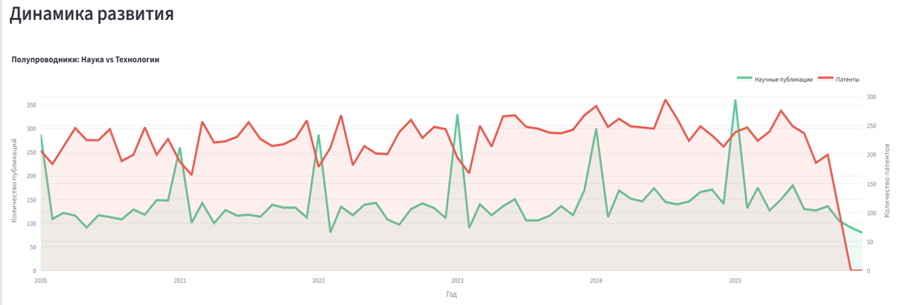
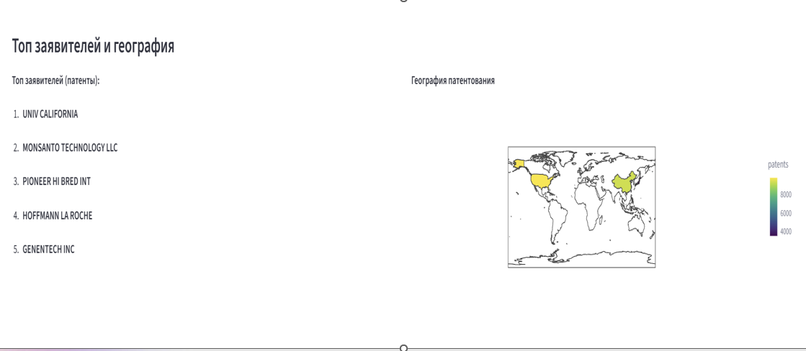

# Tech Trends Monitor (Data Science Platform)

## О проекте
Интерактивная аналитическая платформа для мониторинга перехода науки в технологии. Система собирает данные из открытых источников (OpenAlex, Google Patents), сопоставляет научные публикации и патенты, рассчитывает метрики трендов (Time Lag, Trend Score) и визуализирует их через единый интерфейс.

## Мой вклад в проект (Fullstack AI / Data Engineer)

В рамках командной разработки я отвечала за архитектуру данных, оптимизацию ресурсов, backend-разработку и обеспечение стабильности работы платформы в production-среде.

### Технические достижения и оптимизация ресурсов

Ключевым результатом моей работы стало превращение нестабильного прототипа в production-ready систему за счет глубокой оптимизации потребления памяти и вынесения тяжелых вычислений.

**Масштабируемость данных:**
*   Обработано **4.7 млн патентов** и **660 тыс. научных публикаций**.
*   Выделено **29 технологических кластеров** (586 178 записей), из которых 10 отображаются на дашборде с динамикой по годам.
*   Реализован экспорт отчетов в форматах **CSV, Excel и PDF**.

**Оптимизация памяти и производительности (RAM):**
До оптимизации потребление RAM достигало критических **94–98%**, что приводило к зависаниям. Комплекс мер позволил снизить нагрузку до стабильных **38–45%**:
*   **Выборка данных:** Сокращение объема данных для визуализации с 4.7 млн до 50 тыс. записей (без потери статистической значимости трендов).
*   **Кэширование:** Внедрение `@st.cache_data` для предотвращения повторной загрузки данных при взаимодействии с UI.
*   **Архитектурное разделение:** Тяжелые фоновые расчеты вынесены на отдельную виртуальную машину (ВМ) и в модуль `data_loader.py`. Дашборд (Streamlit) работает только в режиме отображения готовых метрик.
*   **Swap-память:** Увеличение swap-файла с 31 до 61 ГБ для создания буфера при пиковых нагрузках.

**Инфраструктура и автоматизация:**
*   **Автоматическое обновление:** Настроен `cron` для автообновления данных каждый понедельник в 03:00.
*   **Стабильность работы:** Развернут `systemd` сервис с функцией автоматического перезапуска при падении. Время непрерывной работы (Uptime) — более 1 дня 16 часов.
*   **Мониторинг:** Реализован многоуровневый контроль ресурсов:
    *   *OS Level:* `free -h -s 2` (память в реальном времени), `top/htop` (CPU), `journalctl -u streamlit` (логи).
    *   *App Level:* Логирование метрик внутри приложения.

### Результаты внедрения и метрики

| Метрика | До оптимизации | После оптимизации |
| :--- | :--- | :--- |
| **Потребление RAM** | 94–98% (критично) | 38–45% (стабильно) |
| **Пиковая нагрузка RAM** | >95% (падения) | 12 ГБ (80%) |
| **Время загрузки домена** | ~30 сек | 5–8 сек |
| **Время ответа HTTP** | - | 0.0014 сек |
| **Swap использование** | Высокое | Минимальное |

### Аналитические выводы и ключевые метрики

На основе обработанных данных были получены следующие стратегические инсайты:

*   **Time Lag (Наука → Технологии):** Медиана перехода составляет **6.0 лет**, рассчитанная тремя независимыми методами (DOI, regex, fuzzy matching) с перекрестной валидацией.
*   **AI Share (Проникновение ИИ):** Доля патентов с классификацией G06N* в целевых доменах остается низкой:
    *   Полупроводники: **0.41%** (19 400 из 4 694 839).
    *   Генная инженерия: **0.28%** (3 935 из 1 401 218).
*   **Фаза развития доменов:** Полупроводники и Генная инженерия находятся в фазе **Cooling** (Trend Score 14–24/100).
*   **Лидеры:**
    *   Патентование: Samsung, TSMC, IBM.
    *   Публикации: США, Япония, Тайвань, Китай.
*   **Самый быстрорастущий кластер:** RF & Analog Circuits (+68%).
*   **Прогноз:** ML-модель предсказывает стагнацию роста (от 0% до +0.4%) на горизонте 2–3 лет с широкими доверительными интервалами.

### Технологический стек

*   **Язык:** Python.
*   **Web & API:** Streamlit (UI), FastAPI (Backend), Uvicorn (ASGI сервер).
*   **Данные:** Pandas, NumPy, **DuckDB** (для агрегации 33 млн строк без загрузки в RAM), PyArrow, Parquet.
*   **Инфраструктура:** Linux (Ubuntu), systemd, Bash, cron, Nginx.
*   **Визуализация:** Plotly, ReportLab (PDF-экспорт).

### Рекомендации и дальнейшие шаги

*   **Ресурсы:** Текущей конфигурации (15 ГБ RAM + 61 ГБ swap) достаточно для текущей нагрузки. Для production-среды рекомендуется увеличить RAM до 32 ГБ для исключения пиковых нагрузок при переключении доменов.
*   **Масштабирование:** При добавлении новых доменов или увеличении объема данных необходимо внедрить потоковую загрузку данных вместо пакетной выборки.
*   **Стратегия:** Рекомендован мониторинг и поиск новых точек роста в области AI и квантовых технологий.

## Документация и доступ

*   **Дашборд (UI):** http://44.223.240.189:8508
*   **API Docs (Swagger):** http://44.223.240.189:8001/docs

---

## Статус проекта

Цель проекта — создание production-ready прототипа (MVP) аналитической платформы — **полностью выполнена**.

**Достигнутые цели:**
*   **Функциональность:** Дашборд стабильно работает без критических ошибок при переключении доменов «Полупроводники» и «Генная инженерия».
*   **Качество данных:** Обеспечена обработка ≥95% записей, построены чистые и воспроизводимые витрины данных.
*   **Валидация:** Система корректно отображает известные рыночные тренды, включая ускорение и временной лаг.
*   **Прогноз и интерпретируемость:** Достигнуты статистически значимые прогнозы роста патентов на 3 горизонта. Реализована объяснимость модели через SHAP и указана полоса уверенности.
*   **Масштабируемость:** Модульная архитектура готова к добавлению новых доменов и упаковке в Docker.

Финальное решение представляет собой синергию инженерных, аналитических и AI-подходов, объединенных в единую воспроизводимую платформу для стратегической R&D-аналитики.

## Визуализация (Скриншоты реального дашборда)

*Статус системы: обработка более 660 тыс. публикаций и 4,6 млн патентов*

*Dual-Axis график: динамика научных публикаций и патентов*

*KPI-карточки: Time Lag, Trend Score и AI Share*

*Топ заявителей и география патентования (хороплет)*

*Гистограмма распределения временного лага (Time Lag)*
